<p align="center">
  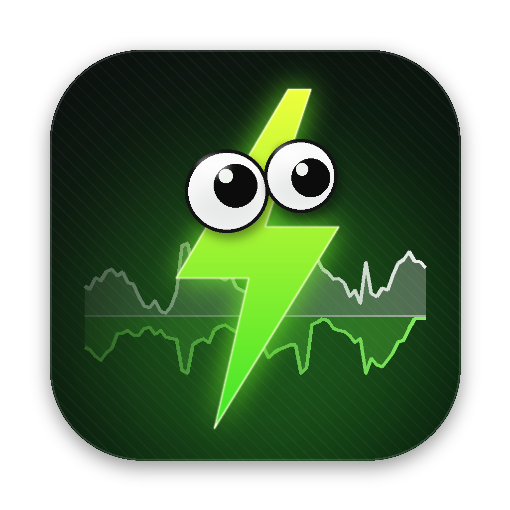
</p>

<h1 align="center">BoostBar</h1>

<p align="center">
  <a href="https://github.com/macsboost/BoostBar/releases/latest/download/BoostBar.zip">
    
  </a>
</p>

<p align="center">
  <b><a href="https://github.com/macsboost/BoostBar/releases/latest/download/BoostBar.zip">Download the latest BoostBar.zip</a></b> · free · macOS 13 or later · Apple silicon &amp; Intel · signed &amp; notarized by Apple<br>
  <sub>Unzip, drag <b>BoostBar</b> to Applications, open it. It lives in your menu bar. <a href="https://github.com/macsboost/BoostBar/releases">All versions</a></sub>
</p>

<p align="center">
  <a href="https://github.com/macsboost/BoostBar/releases/latest/download/BoostBar-Setup.exe">
    
  </a><br>
  <sub><b><a href="https://github.com/macsboost/BoostBar/releases/latest/download/BoostBar-Setup.exe">BoostBar-Setup.exe</a></b> · Windows 10 (1809+) and 11 · <a href="#boostbar-for-windows">details</a></sub>
</p>

<p align="center">
  
  
</p>

<p align="center">
  
</p>

<p align="center">
  <i>“This is the greatest utility since flying bread.”</i><br><sub>— SeaNet</sub>
</p>

<p align="center">
  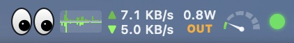
  <br><sub>Real menu bar: googly eyes · network · battery watts · CPU meter (boost gauge style) · disk light</sub>
</p>
<p align="center">
  <a href="docs/media/cpu-spectrum.mp4">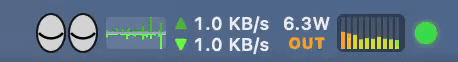</a>
  <br><sub>Live: the CPU spectrum analyzer, one bar per core, here with the dark backdrop. Looks very cool on Apple silicon! · <a href="docs/media/cpu-spectrum.mp4">Watch in full quality (MP4)</a></sub>
</p>
<p align="center">
  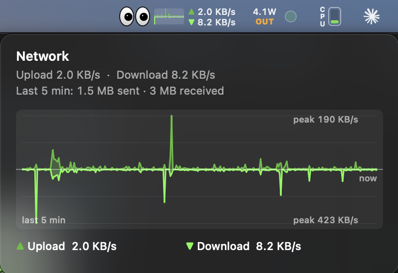
  <br><sub>Hover any piece for its chart — here the disk light: the drive, free space, and the last minute of reads and writes</sub>
</p>

<h3 align="center">Three Flying Bread–style screen savers included</h3>
<table align="center">
  <tr>
    <td align="center"><a href="docs/media/flying-cars.mp4">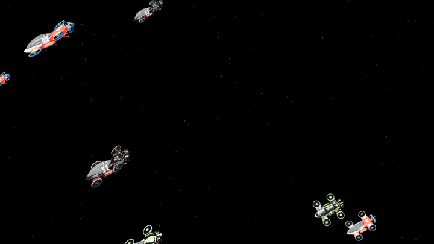</a><br><b>Flying Cars</b><br><sub>X1 SkyRacers, fans spinning</sub></td>
    <td align="center"><a href="docs/media/starships.mp4">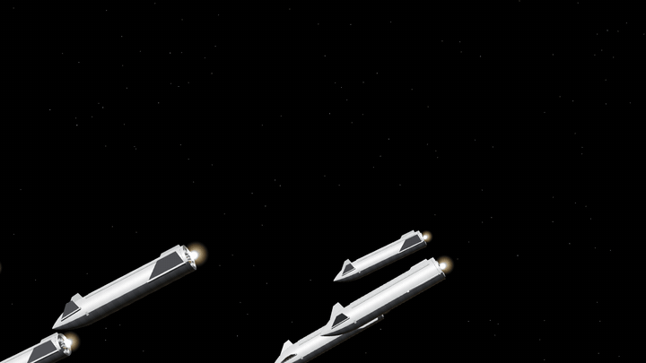</a><br><b>Starships</b><br><sub>flaps beating like wings</sub></td>
    <td align="center"><a href="docs/media/starlink.mp4">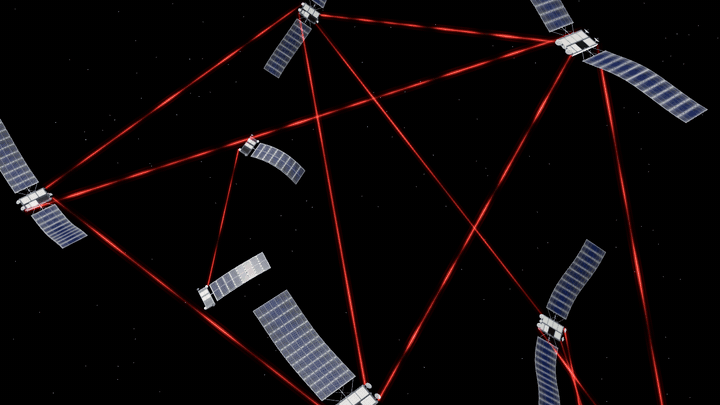</a><br><b>Starlink</b><br><sub>V1.5, V2 &amp; V3, flapping, with laser links</sub></td>
  </tr>
</table>

---

A small native macOS menu bar app from [MacsBoost](https://macsboost.com). It has no Dock icon and uses about 1% CPU or less.

```
 ● ▕▔▔▔▔▔▔▔▔▔▔▏ ▲ 42 KB/s
   ▕▁▁▁▁▁▁▁▁▁▁▏ ▼ 1.3 MB/s
```

- **Live bandwidth graph:** the last 30 seconds of traffic in one box. Upload grows up from the center line and download grows down, in MacsBoost green and lime by default (Settings ▸ Network ▸ Trace Colors has white, red/blue and any color you like). The current rates sit beside the graph. You can switch between KB/s and Kb/s.
- **One graph per connection:** with Ethernet and Wi‑Fi (or an iPhone hotspot, USB LAN adapter…) connected at once, each gets its own little graph with an icon, and hovering one shows that connection's 5-minute chart. Prefer one combined graph? Settings ▸ Network ▸ Graphs.
- **Battery power readout:** shows how many watts are going into the battery (green **IN**) or out of it (orange **OUT**). Hover over it to see the estimated time until full or empty, plus what the power adapter is supplying on Apple Silicon Macs.
- **Googly eyes:** a pair of eyes (or a single cyclops eye) that follow your mouse from the menu bar, with springy pupils and the occasional blink. Small, medium or large.
- **Settings window** (⌘, from the menu) with tabs for General, Sleep, Network, Battery, Disks, Eyes and Scrolling. Keep Awake stays in the menu for one-click access.
- **Rearrange the pieces:** Settings ▸ General ▸ Menu Bar Layout lists the eyes, network graph, battery watts and disk lights — drag the rows or use Left / Right. You can also drag a piece left or right right in the menu bar. Reset Order puts it back.
- **Choose what's shown:** the network graph and the battery readout can each be turned on or off from the menu.
- **Reverse mouse scrolling:** flips the wheel direction in every app. You can keep the trackpad's natural scrolling, or reverse it too, plus optional horizontal scrolling.
- **Keep Mac awake:** one click (⌘K in the menu) keeps the Mac awake indefinitely, or pick 15 min to 8 h. You can keep the display on too. No admin rights needed. The googly eyes turn bloodshot while it's on.
- **Stay awake with the lid closed:** toggles `pmset -a disablesleep`. It needs admin rights, so macOS asks for your password. Or turn on **Lid Toggle Without Password**. That installs a sudoers rule for your user that allows only `pmset -a disablesleep 0|1`.
- **Launch at login:** a checkbox in the menu that uses the native macOS login-item API.
- **Self-updating:** checks GitHub Releases at launch, or when you pick **Check for Updates…**. It can download, swap, and relaunch in one click.

The googly eyes go **bloodshot** while BoostBar is keeping your Mac awake, so you can tell at a glance — they clear up again when Keep Awake turns off (Settings ▸ Eyes ▸ Bloodshot while keeping the Mac awake).

## BoostBar for Windows 🪟

The same strip — googly eyes, network graph, battery watts, CPU meter and disk lights — sits **on the Windows taskbar**, just left of the clock and tray icons. It follows the taskbar's light or dark theme, hovering any piece opens its chart, left-click opens the menu (click the eyes for About), and you can drag a piece along the taskbar to reorder it. Prefer it elsewhere? **Settings ▸ General ▸ Show BoostBar ▸ As a floating bar** gives a bar you can drag anywhere. There's also a tray icon with the same menu.

- **Install:** download [BoostBar-Setup.exe](https://github.com/macsboost/BoostBar/releases/latest/download/BoostBar-Setup.exe) and run it. It installs just for you in `%LOCALAPPDATA%\Programs\BoostBar` — no admin prompt — and can start BoostBar when you sign in. The installer isn't code-signed, so Windows SmartScreen may say it "protected your PC": click **More info ▸ Run anyway**.
- **Keep Awake** keeps the PC (and optionally the display) awake, indefinitely or for 15 min to 8 h.
- **Stay awake with the lid closed** (laptops) sets the power plan's lid action to *Do nothing*, plugged in and on battery, and puts your old setting back when you turn it off. Like on the Mac it stays on after quitting until you turn it off.
- **Reverse mouse scrolling** in every app, with no permission needed. (Touchpads keep their own setting in Windows Settings.)
- **Hot corners** for Keep Awake, Sleep now and the screen saver.
- **Screen savers:** Flying Cars, Starships, Starlink and Jet Racers are installed too. In **Settings ▸ Screen Saver** pick one, set its options, **Preview** it, and click **Use as My Screen Saver** — Windows lets apps set it directly. They need the Microsoft Edge WebView2 Runtime, which is built into Windows 11 and nearly every Windows 10 PC.
- **Updates:** BoostBar checks this page at startup. The download is checked against the SHA-256 checksum published with each release before it installs (silently, if you turn on automatic updates).
- Settings live in `HKEY_CURRENT_USER\Software\MacsBoost\BoostBar`. Not on Windows: the dizzy (shake) eyes, which need the MacBook's motion sensor.
- **Eye emotions** work on Windows too (Settings ▸ Eyes ▸ Emotions). Windows has no thermal reading BoostBar can use, so there the eyes sweat after the CPU has run flat out for a minute instead.

Build it yourself on Windows with the .NET SDK, Python 3 and Inno Setup 6: `pwsh windows/build.ps1` → `build/win/out/BoostBar-Setup.exe`. Source is in [`windows/`](windows); GitHub Actions builds it and attaches the installer to each release.

## Flying Cars screen saver ✈️

<p align="center">
  
  <br><sub><a href="docs/media/flying-cars.mp4">Watch in full quality (MP4)</a></sub>
</p>

BoostBar ships with **BoostBar Flying Cars**, a screen saver in the spirit of the classic Flying Bread. X1 SkyRacers fly across the screen in a loose flock with their rotors and thruster fans spinning, painted in MacsBoost, Yonder 01 and XXONE 51 liveries. Open **Settings ▸ Screen Saver** to preview it, install it or start it now. To pick liveries, number of cars, speed and stars, go to System Settings ▸ Screen Saver ▸ BoostBar Flying Cars ▸ Options. (Direct download only.) Tick **Clouds** for a blue daytime sky with puffy clouds drifting by at different depths — some behind the cars, some in front — in the spirit of the old After Dark screen savers.

## Screen saver options

Set them in **BoostBar ▸ Settings ▸ Screen Saver**: pick the screen saver at the top, then how many fly, **Speed** across the screen, **Flap speed** (fan speed for the flying cars), **Angle** (how far they're rolled toward you), **Stunts** on/off (barrel rolls, veers, climbs and dives), stars, plus liveries (Flying Cars), V2/V3 (Starlink) and **Oxidation** (Starships). **Install & Show in System Settings** copies the screen saver into your Screen Savers folder and opens System Settings ▸ Wallpaper; click it under **Other** (at the end) to use it — macOS doesn't let apps choose the screen saver for you.

## Starships screen saver 🚀

<p align="center">
  
  <br><sub><a href="docs/media/starships.mp4">Watch in full quality (MP4)</a></sub>
</p>

**BoostBar Starships** is the second screen saver: a fleet of Starships glides across the screen Flying Bread style, all four flaps beating like the bread's wings, with the Raptors glowing. They barrel-roll, climb, dive and bump off each other just like the flying cars. An **Oxidation** slider in its Options takes the heat shield from fresh black tiles to a full post-re-entry look on the belly: frosty white streaks swept back from the nose, scorched dark tiles in the middle and rust-orange toward the rear. The model is Ship 42 from the X1 SkyRacer sim's Starbase world, built from code. Preview and install it in **Settings ▸ Screen Saver**, and set how many fly, how fast, and stars in its Options. (Direct download only. Not affiliated with SpaceX.) Tick **Roadster with Starman** to send a red open-top roadster through with them — a spacesuited driver at the wheel, one arm on the door, wheels spinning as it tumbles slowly along, or tick **Stabilized** to have it fly level with the ships (an original model, `tools/roadster_glb.py`).

## Starlink screen saver 🛰

<p align="center">
  
  <br><sub><a href="docs/media/starlink.mp4">Watch in full quality (MP4)</a></sub>
</p>

**BoostBar Starlink** sends Starlink V2 and V3 satellites across the screen Flying Bread style. The bus is the loaf; the long solar wings are chains of hinged modules that bend between panels, so each wingbeat rolls out from the body to the tips like a bird's — a quick downstroke, a slower upstroke, the body lifting a little on each beat. Pick **V1.5** (which creeps along in straight lines like an inchworm), **V2, V3** and/or **V3 deploying** in its Options — the deploying ones arrive with their arrays fan-folded in a stack on the bus, unfold them straight up, lay them out flat, then start flapping. Turn on **Crossing orbits** to send them along two sets of lanes that cross in an X, each leg at its own altitude, and **Laser links** for red, shimmering inter-satellite lasers that hop between neighbours — on screen and off — making each new link before breaking an old one. The models are original V2 and V3 satellites made for BoostBar (`tools/starlink_glb.py`). (Direct download only. Not affiliated with SpaceX.)

## Jet Racers screen saver 🏁

<p align="center">
  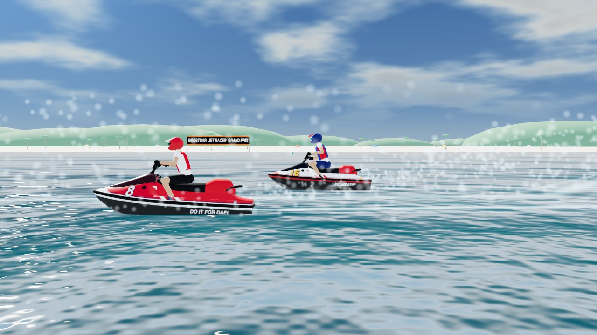
</p>

**BoostBar Jet Racers** is a race, not a flock. Three jet racers — Skeeter on #16, Skison on #8 and Jorge on #3 — line up behind a rubber band, the band snaps, and they race a buoy course for about two minutes: red buoys are left turns, green are right, and two checkered buoys mark the finish. Every race gets a new course. A director cuts between chase, trackside, onboard, helicopter, buoy and finish-line cameras, a leaderboard keeps the gaps, and the winner spins out in a wall of spray and celebrates.

<p align="center">
  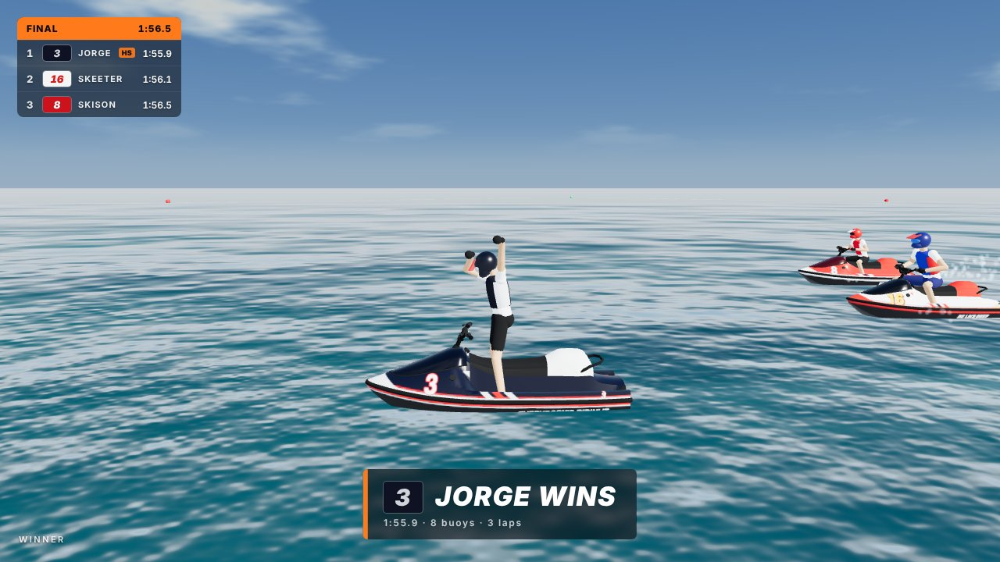
</p>

Its options, in **BoostBar ▸ Settings ▸ Screen Saver** (and in the saver's own Options on the Mac):

- **Winner:** *Random* runs a fair race that any of the three can win. Pick a racer and that racer wins every race — still a real race, with a different course and a different fight each time.
- **Celebration:** *Random*, or always one of: stand and shake arms, take a bow, the formal bow with one arm up, a backflip off the seat, the dab, the shopping cart dance, the lawn mower, the sprinkler, or the crane kick.
- **Camera** and **Follow:** leave it to the director, or hold one camera, on the race leader or on one racer.
- **Leaderboard** and **Camera captions** on or off.

## CPU spectrum analyzer and boost gauge

Between the battery readout and the disk light sits a **CPU spectrum analyzer**: every core gets its own slim bar, bouncing like an equalizer on a dark plate, coloured green through yellow and orange to red — on Apple silicon you can watch the efficiency and performance cores trade the load. **Peak hold** leaves a thin cap at the top of each core's last surge (1.5 s by default, up to 10 s) before it falls. Prefer a dial? **Settings ▸ CPU ▸ Style ▸ Boost gauge** swaps in a tiny half-round gauge for all cores together: a crescent that thickens toward full boost, lit up to the needle, like the gauge on the [X1 SkyRacer sim](https://x1racing.com/sim)'s loading screen. The **Backdrop** slider sets the translucent dark or light plate behind either style (or turns it off). The colours adjust for a light or dark menu bar, hovering shows a 5-minute chart, and **Update rate** sets how often it reads the CPU, from once a second to 60 times a second on a logarithmic slider — the damping follows it automatically.

## Updates

BoostBar checks GitHub for a newer release when it starts, and you can check any time from the menu. Turn on **Settings ▸ General ▸ Install updates automatically** (or tick "Install future updates automatically" on the update prompt) and new versions are downloaded, verified as Apple-notarized and signed by MacsBoost, swapped in and relaunched with no prompt.

## Spin the eyes

Circle the pointer right over the googly eyes in the menu bar two and a half times and the pupils hop onto an internal wheel: it spins on a vertical axis, so the pupils slide out of one eye and into the other, and it turns as fast (and the same way) as you're circling. Stop, and the wheel keeps coasting for a few seconds before the pupils snap back to following the pointer.

**Emotions.** The eyes react to what the Mac is doing: **sleepy** lids that droop the longer it sits idle, **alarmed** pinprick pupils when the CPU pegs or the battery hits 10%, **angry** when the CPU stays in the red, a **sweat** drop when it runs hot, **happy** arcs when you plug in the charger or a big download finishes, **sad** with no network, a **suspicious** squint at a lingering pointer, a one-eyed **skeptical** squint when you whip the pointer across the screen (the eye on the pointer's side, harder the faster you go), **startled** by a new drive, a **bored** eye-roll now and then — and **heart and dollar eyes** for a tip. Each one has its own checkbox in **Settings ▸ Eyes ▸ Emotions**, — hover over a name there to see the eyes do it.

<p align="center">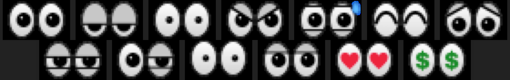</p>

## Dizzy eyes

On MacBooks with Apple silicon, give the Mac a few firm shakes: the googly eyes squeeze shut while it's shaking, then pop open with their pupils spinning. Bumps, carrying it around and car rides don't trigger it. BoostBar reads the MacBook's built-in motion sensor (the undocumented IMU behind the Sensor Processing Unit) whenever the eyes are shown; there's no setting to turn on. Direct download only.

## Hot corners

In **Settings ▸ Sleep ▸ Hot Corners**, choose a screen corner to toggle **Keep Awake** and one to **Sleep now**. Rest the pointer in the corner for a moment, and a small badge confirms the action.

## Install

Requires macOS 13 Ventura or newer. Runs natively on Apple Silicon and Intel.

```sh
curl -L https://github.com/macsboost/BoostBar/releases/latest/download/BoostBar.zip -o /tmp/BoostBar.zip
ditto -x -k /tmp/BoostBar.zip /Applications
open /Applications/BoostBar.app
```

You can also download `BoostBar.zip` from [Releases](https://github.com/macsboost/BoostBar/releases) and drag the app into **/Applications**. Release builds are signed with a Developer ID and notarized by Apple when the signing secrets below are set. Until then they are ad-hoc signed: right-click the app and choose **Open** the first time, or run `xattr -dr com.apple.quarantine /Applications/BoostBar.app`.

Keep the app in /Applications. Launch at login and in-place updates need it there.

### Permissions

- **Reverse scrolling** needs **System Settings ▸ Privacy & Security ▸ Accessibility ▸ BoostBar**. Whenever reverse scrolling is on but this permission is off (first run, after an update, or if it gets switched off), BoostBar shows a guide picture of exactly which switch to turn on, with a button that opens that settings page. The guide closes itself once the permission is on.
  Because builds are ad-hoc signed, macOS may forget this permission after an update. If scrolling stops reversing, toggle BoostBar off and on in that list, or remove it and add it again.
- **Lid-closed sleep** asks for your admin password each time unless the password-free rule is installed.

## Notes

- Lid-closed sleep uses `pmset disablesleep`, a system-wide setting that **stays on after you quit or restart** until you turn it off. Don't put a running Mac in a bag with it on.
- Keep Awake uses an IOKit power assertion. It ends when you turn it off, when the timer runs out, or when BoostBar quits.
- Mouse vs. trackpad is detected from the scroll event's "continuous" flag. A Magic Mouse counts as a trackpad, so turn on "Include Trackpad / Magic Mouse" if you use one.
- Bandwidth counts physical interfaces (Wi-Fi, Ethernet, USB/Thunderbolt). It skips loopback and VPN tunnel interfaces so traffic isn't counted twice.
- "Launch at Login" starts BoostBar when you log in. If your Mac logs in automatically, it starts at boot.

## Build from source

```sh
git clone https://github.com/macsboost/BoostBar && cd BoostBar
./scripts/build-app.sh          # -> dist/BoostBar.app (native arch)
UNIVERSAL=1 ./scripts/build-app.sh   # arm64 + x86_64, needs full Xcode
```

## Releasing

Bump `VERSION` (e.g. `1.0.1`) and push to `main`. GitHub Actions builds a universal `BoostBar.zip` and publishes release `v1.0.1`. Running copies of the app pick it up the next time they check. Pushing a `v*` tag works too.

## Code signing & notarization (CI)

The workflow signs with a **Developer ID Application** certificate and notarizes with an App Store Connect API key when these repository secrets exist (Settings ▸ Secrets and variables ▸ Actions):

| Secret | Value |
|---|---|
| `MACOS_CERT_P12` | base64 of the exported Developer ID Application `.p12` (cert + private key) |
| `MACOS_CERT_PASSWORD` | the password you set when exporting the `.p12` |
| `APPLE_API_KEY_P8` | contents of `AuthKey_XXXXXXXXXX.p8` (raw text or base64) |
| `APPLE_API_KEY_ID` | the key's 10-character Key ID |
| `APPLE_API_ISSUER_ID` | the Issuer ID (UUID) shown above the keys list |

Without them, builds fall back to ad-hoc signing.

## Energydrinkware ⚡

BoostBar is free. If you like it, buy me an energy drink ($4.95):
[PayPal](https://www.paypal.com/cgi-bin/webscr?cmd=_xclick&business=mac@supermac.net&item_name=BoostBar%20energy%20drink&amount=4.95&currency_code=USD&no_shipping=1) ·
[Venmo](https://venmo.com/u/john-mcalpine-16) ·
[Card (Stripe)](https://biz-cord.com/boostbar/donate)

More from MacsBoost: [macsboost.com](https://macsboost.com) · [ssi-d.com](https://ssi-d.com) · [x1racing.com](https://x1racing.com) · [buildflyingcars.com](https://buildflyingcars.com) · [biz-cord.com](https://biz-cord.com)

### Thanks

Thanks to Dave Plummer for the HDD LED inspiration. Check out [TMOG (Task Manager OG)](https://tmog.org).

### Install count

BoostBar sends one anonymous message to biz-cord.com per version per Mac. It contains a random ID, the app version, the macOS version and the CPU type, with no personal info. Turn it off with **Share Anonymous Install Count** in the menu. The server side is described in [docs/biz-cord-endpoints.md](docs/biz-cord-endpoints.md).

## License

MIT
